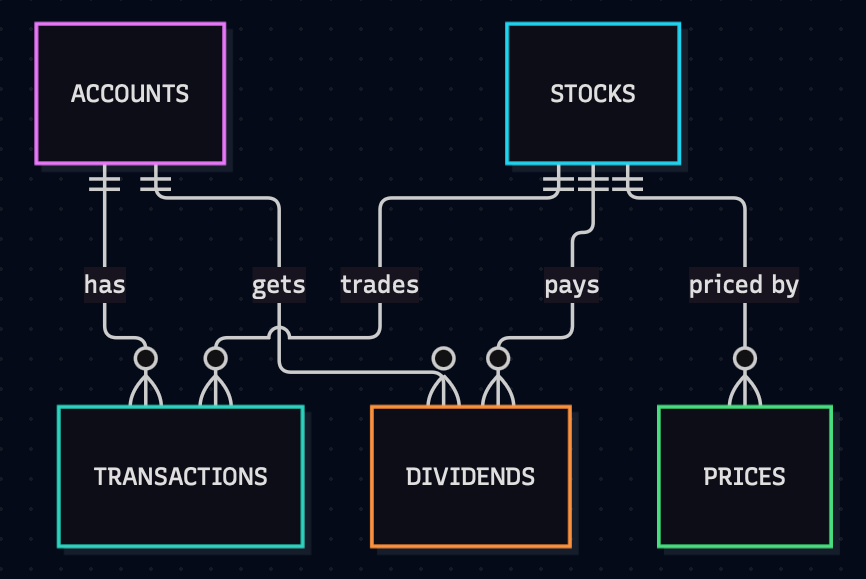

# sql-investment-portfolio-tracker
Final project for CS50's Introduction to Databases with SQL: an investment portfolio tracker in SQLite, with buys, sells, dividends, prices, views, an index, and a sell-check trigger.

## Scope

### Purpose

This database is a personal investment portfolio tracker. It records the buys and sells of stocks across one or more accounts, the dividends paid on those stocks, and the daily closing prices used to value them.

Its main question is: **which stocks paid the most dividends last year?** It also shows how many shares are held, what those holdings are worth, how dividend income is spread across sectors and months, and how the accounts compare.

### In scope

- Accounts, such as a brokerage or a retirement account
- Stocks, identified by `ticker`, with a `name` and a `sector`
- Buy and sell transactions, with `date`, `shares`, and `price` per share
- Dividend payments, stored per share, with `pay_date`
- Daily closing prices, used to value current holdings

### Out of scope

- Fees and commissions
- Taxes, including withholding tax and capital gains tax
- Cash balances and interest
- Stock splits and mergers
- Multiple currencies
- Live market data, which is loaded from downloaded files

---

## Functional Requirements

### What a user can do

- See which stocks paid the most dividends in 2025
- See the shares currently held for each `ticker` in each `account_id`
- See the market value of each holding at its latest `close`
- See dividend income by `sector` and by month
- See the dividend yield of each holding
- Compare total dividends and total buy cost across accounts
- Record a buy or a sell, where a sell is rejected if it is larger than the shares currently held
- Ensure that every dividend, transaction, and price refers to a stock that exists

### What is beyond scope

- Calculating realized gains or losses
- Handling splits, mergers, or currency conversion
- Importing data automatically from a broker or a price service
- Reporting for any year other than 2025 in the income views

---

## Representation

### Entities

The database has five tables. Each one has an `id` column as its primary key. This follows the course convention and gives every row a simple reference number.

#### accounts

Stores each account that holds stocks.

- **`id`**: a unique number for each account. It is the primary key.
- **`name`**: a label the user recognizes, such as "Main Brokerage". It is required.
- **`type`**: the kind of account, such as brokerage or retirement. It is required and accepts any text. The database does not restrict it to a fixed list.

#### stocks

Stores each stock the portfolio can hold.

- **`id`**: a unique number for each stock. It is the primary key.
- **`ticker`**: the short market code, such as AAPL. It must be unique, because the other tables refer to it.
- **`name`**: the full company name, used for readable output. It is required.
- **`sector`**: the industry group the stock belongs to, used by the sector income view. It is required.

#### transactions

Stores each buy and sell.

- **`id`**: a unique number for each trade. It is the primary key.
- **`account_id`**: the account the trade belongs to. It must match an existing account. It is required.
- **`ticker`**: the stock that was traded. It must match an existing stock. It is required.
- **`date`**: the trade date, stored as text in the form YYYY-MM-DD. It is required.
- **`type`**: either buy or sell. No other value is allowed.
- **`shares`**: how many shares were traded. It must be greater than zero. It is stored as a number, so fractional shares are allowed.
- **`price`**: the price per share. It must be greater than zero. It is stored as a number so that decimal prices stay exact.

#### dividends

Stores each dividend payment.

- **`id`**: a unique number for each payment. It is the primary key.
- **`account_id`**: the account that received the payment. It must match an existing account. It is required.
- **`ticker`**: the stock that paid it. It must match an existing stock. It is required.
- **`pay_date`**: the date the dividend was paid, stored as text in the form YYYY-MM-DD. It is required, and the income views filter on it.
- **`amount_per_share`**: the dividend for one share. It must be greater than zero. It is stored per share, not as the total cash received.

#### prices

Stores the daily closing price of each stock.

- **`id`**: a unique number for each price row. It is the primary key.
- **`ticker`**: the stock the price belongs to. It must match an existing stock. It is required.
- **`date`**: the trading day of the close. It is required.
- **`close`**: the closing price for that day. It must be greater than zero.

The pair of `ticker` and `date` must be unique. This means each stock has at most one closing price per day, so a repeated import cannot give two different prices for the same day.

### Relationships

The entity relationship diagram was created with Mermaid (mermaid.live) and saved as `diagram.png` in the project folder.

- **accounts to transactions** (one to many): one account has many trades, and each trade belongs to one account.
- **accounts to dividends** (one to many): one account receives many payments, and each payment goes to one account.
- **stocks to transactions** (one to many): one stock appears in many trades.
- **stocks to dividends** (one to many): one stock pays many dividends.
- **stocks to prices** (one to many): one stock has a closing price for many days.

---

## Optimizations

### Views

Views are saved queries. Each one keeps its logic in one place, so the answers can be reused without rewriting them.

- **`holdings`**: shares owned for each `ticker` in each `account_id`, calculated as total `shares` bought minus total `shares` sold. It is the base for the `current_values` view and the sell check.
- **`current_values`**: market value of each holding, using the `holdings` view and the latest `close` of each stock.
- **`dividends_by_sector`**: dividends received in 2025, grouped by `sector`.
- **`monthly_income`**: dividends received in 2025, grouped by month. The month comes from the first seven characters of `pay_date`.
- **`dividend_yield`**: `amount_per_share` divided by the total buy cost, for each `ticker` in each `account_id`.
- **`account_summary`**: total `amount_per_share` and total buy cost for each `account_id`, side by side.

### Indexes

- **`dividends_ticker_pay_date`**: an index on `ticker` and `pay_date` in the `dividends` table. It speeds up the queries that group dividends by stock and filter them by pay date. Because `ticker` is the first column, it helps most when a query looks up a particular stock. A filter on the year alone cannot use it as a search.
- **`transactions_type_ticker_account`**: an index on `type`, `ticker`, and `account_id` in the `transactions` table. The holdings, cost, yield, and sell check queries all filter by `type` first and then group by `ticker` and `account_id`. The order of the columns matches that filter, so the index can be used.

Indexes on the `prices` and `stocks` tables are not created separately, because their unique rules already create one automatically.

### Trigger

- **`sell_check`**: runs before each new transaction is saved. If the new transaction is a sell, it compares the number of `shares` being sold with the shares currently held for that `ticker` in that `account_id`. If the sell is larger, the insert is stopped with an error message. A stock with no holdings counts as zero, so selling a stock you never bought is also rejected. The rule sits in the database, so every entry is checked no matter how it is made.

---

## Limitations

- **Hardcoded year:** the income views always use 2025, so they do not move forward on their own. A view in SQLite cannot take a parameter.
- **Per-share dividends:** the stored `amount_per_share` is not the cash received. The payout depends on how many shares were held on each `pay_date`, which the model does not track.
- **Inner joins drop rows:** a stock with buys but no sells, or with no `close` price, does not appear in the current values or dividend yield views.
- **Gross cost:** the buy cost is the total of all buys. Sells do not reduce it, so the yield and the account cost are understated for accounts that have sold.
- **Account type is not restricted:** the `type` column in `accounts` accepts any text, so a mistyped account type is not caught.
- **Dividend index order:** because `ticker` is the first column, a year filter alone does not use the dividends index as a search.
- **Check on insert only:** the sell check runs when a row is added. An update that changes the `shares` of a sell is not checked.
- **Entry order:** a buy entered after a sell is not checked against that sell, so the order of entries can still matter.
- **Missing features:** no fees, taxes, cash balances, splits, mergers, or currency conversion.
- **Data assumptions:** each `ticker` is unique, and prices exist for every trading day a stock was held.
- **Small sample:** with few rows, SQLite may still scan a table even when an index exists, because a scan is faster for small tables.
